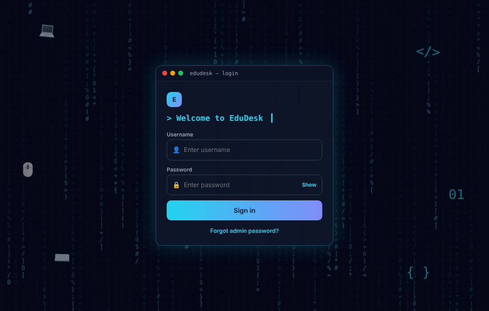
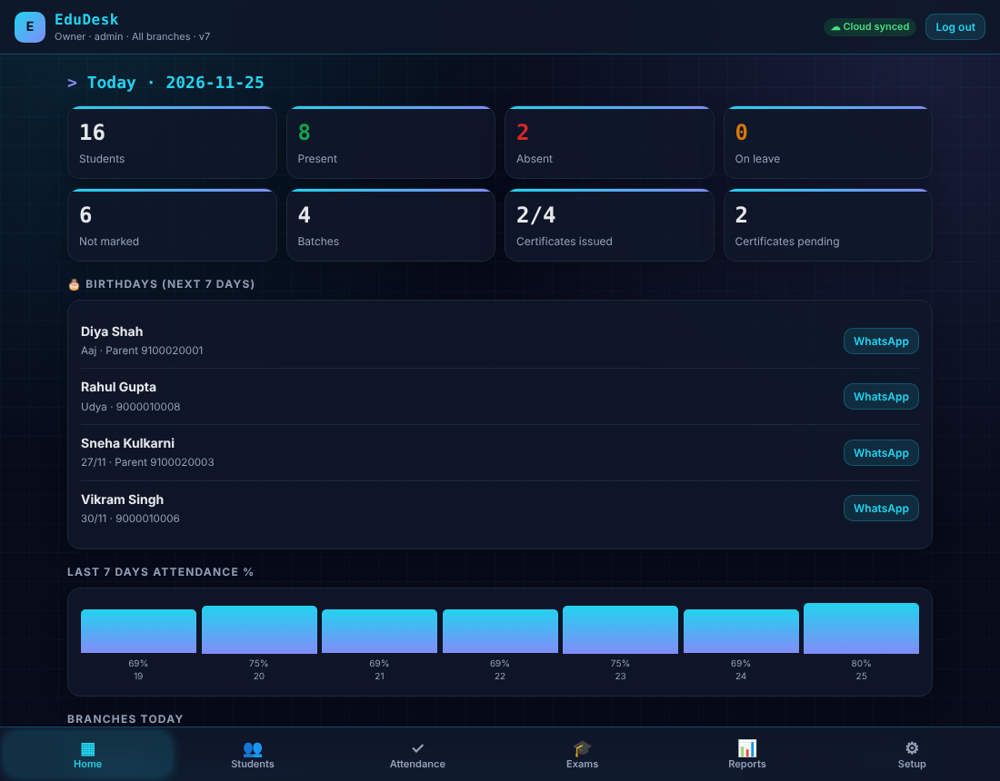
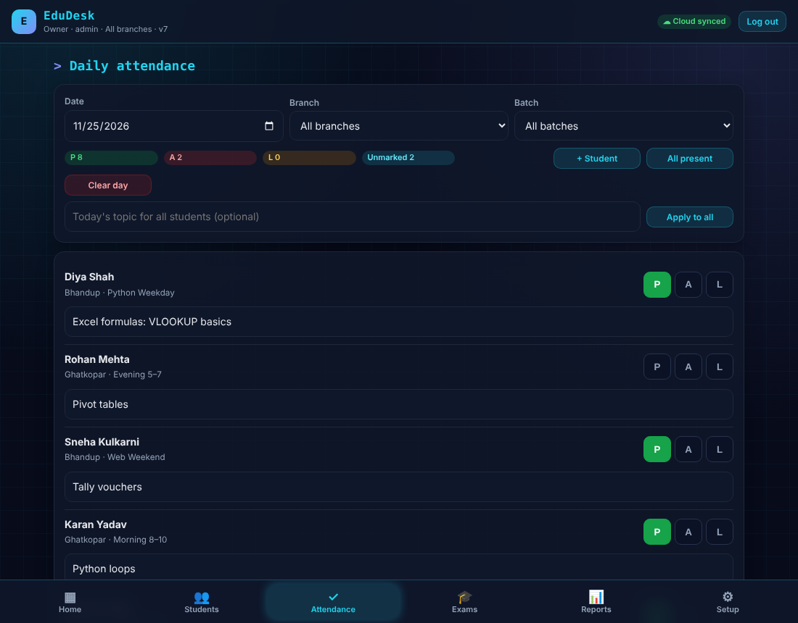
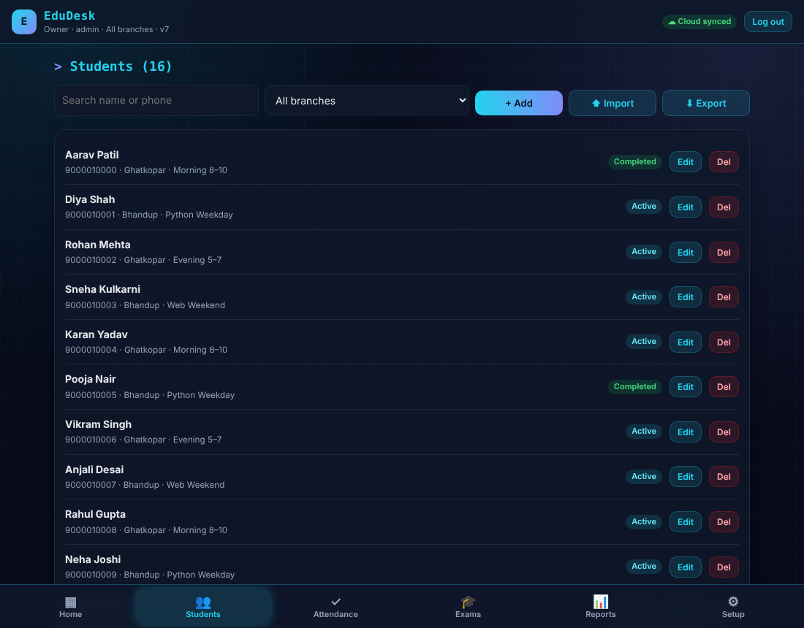
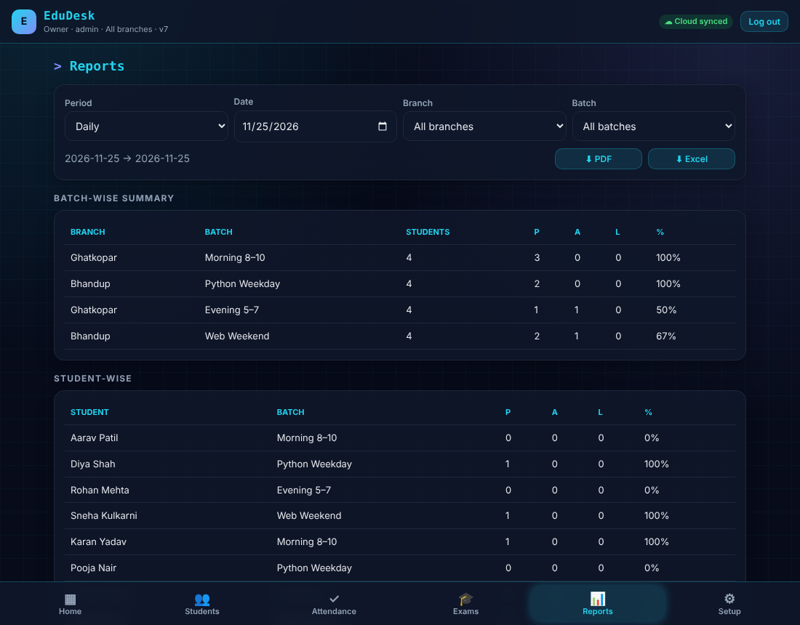
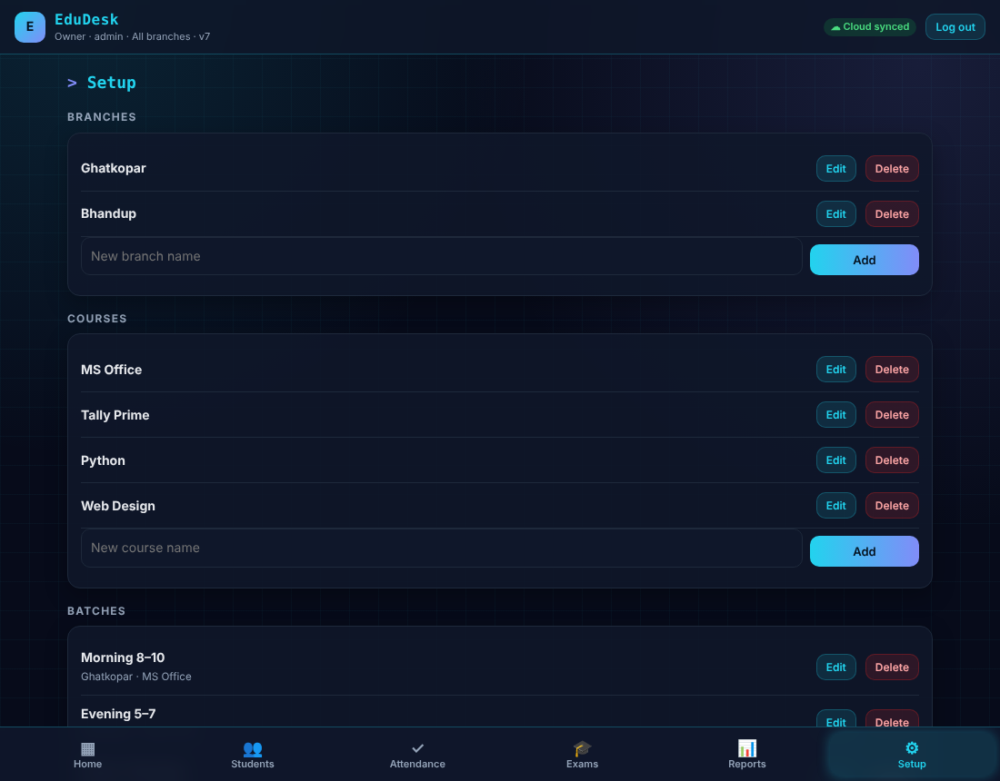
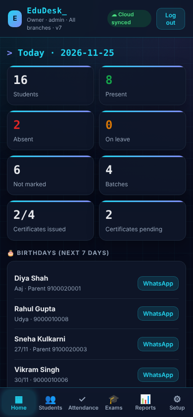

# EduDesk – Computer Institute Student Management System

EduDesk is a lightweight, mobile-friendly web app for running a multi-branch computer institute. It handles students, batches, daily attendance, exams, certificates and reports from a single page, with data synced to the cloud so the whole team sees the same records.

**Live demo:** https://edudesk.mahapadiyogesh96.workers.dev

## Screenshots

All screenshots use sample data.

| Login | Dashboard |
| --- | --- |
|  |  |

| Attendance | Students |
| --- | --- |
|  |  |

| Reports | Setup |
| --- | --- |
|  |  |

| Mobile |
| --- |
|  |

## Features

**Institute setup**
- Multiple branches, courses and batches (add, rename, delete)
- Role-based staff logins: Admin, Manager, Staff and Teacher, each with its own permissions
- Branch-restricted access, so staff only see their own branch

**Students**
- Add, edit and delete students with phone, parent/second phone and date of birth
- Search by name or phone, filter by branch
- Import students from Excel/CSV (columns are detected by name) and export to Excel
- Status tracking: Active, Completed, Dropped. Completed and Dropped students are hidden from daily attendance but keep all their history; moving a Completed student to a new batch makes them Active again

**Attendance**
- Daily attendance per branch and batch with Present / Absent / Leave
- "What was taught today" note per student, or one topic applied to all
- One-tap "All present", tap-again-to-correct, and clear day

**Exams and certificates**
- Exam records with result per student
- Course completion and certificate issued / pending tracking

**Birthdays**
- Dashboard card showing birthdays for the next 7 days
- One-click WhatsApp message (WhatsApp Web / app) with an editable message template. The message goes to the parent/second number if present, otherwise the student's number
- "Sent" marker so nobody gets wished twice

**Dashboard and reports**
- Daily stats, last 7 days attendance chart, branch-wise summary
- Daily, weekly and monthly reports: batch-wise, student-wise and date-wise (P/A/L grid)
- Export reports to PDF and Excel (including topics taught)

**Data safety**
- Cloud sync with automatic refresh
- Full JSON backup and restore
- Admin password recovery with a recovery key

## Tech stack

| Area | Technology |
| --- | --- |
| Frontend | Vanilla HTML, CSS and JavaScript in a single `index.html` (no build step) |
| Cloud database | Supabase (REST API) |
| PDF / Excel | jsPDF + AutoTable, SheetJS (xlsx) |
| Hosting | Cloudflare Workers (static assets), auto-deployed from this repository |
| UI | Responsive, dark tech theme, installable-style mobile layout |

## Project structure

```
edudesk/
├── index.html   # the entire application (UI, logic, styles)
└── README.md
```

## Run locally

No installation is needed. Download `index.html` and open it in a browser. Without cloud access the app falls back to local browser storage.

## Deployment

Every commit to the `main` branch is deployed automatically by Cloudflare. To release a change, edit `index.html`, commit, and wait about a minute. The version label in the top bar confirms which version is live.

## Roadmap

- Fee tracking with payment history and pending-fee reminders
- Student progress report cards
- Batch completion reminders

## Security note

Change the default admin password after first login, and keep backup files private because they contain all student and login data.

## Author

Built by **Yogesh Mahapadi**.
